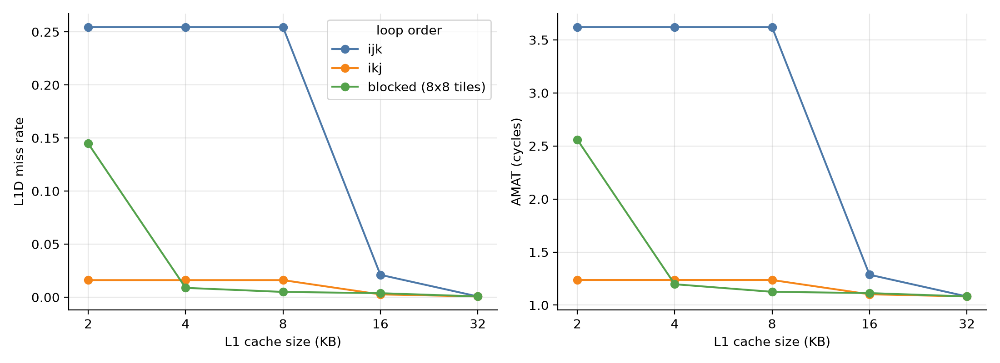

# Cache Memory Simulator

A trace-driven, cycle-accurate simulator of a two-level cache hierarchy, written
in Python. Course project for CS5375 (Computer Systems Organization and
Architecture), Fall 2026, Topic 4: Memory Hierarchy Design.

The simulator reads a memory access trace, runs it through a split L1 cache
(instruction + data), a unified L2 cache and main memory, and reports hits,
misses, total cycles and average memory access time (AMAT).

## What it models

- Mapping: direct-mapped, N-way set-associative, fully associative
- Replacement: LRU, FIFO, Random (seeded, so runs are repeatable)
- Write policies: write-back with write-allocate, write-through with no-write-allocate
- Timing: L1 hit 1 cycle, +10 cycles for an L2 hit, +100 cycles for main memory
- Miss classification (3C model): compulsory, capacity, conflict
- Metrics: hit and miss rates per cache, total cycles, AMAT, writebacks, memory traffic

`SPEC.md` has the exact timing model and all assumptions.

## Setup

Python 3.11 or newer (the config loader uses the built-in `tomllib`).

```
python -m venv .venv
.venv\Scripts\Activate.ps1          # Windows PowerShell
# source .venv/bin/activate         # macOS / Linux
pip install -r requirements.txt
```

## Usage

Run the tests:

```
python -m pytest -q
```

Generate the traces (about 45 MB, not stored in git):

```
python -m cachesim.tracegen
```

Simulate one trace with one configuration:

```
python -m cachesim --config configs/default.toml --trace traces/vecadd.din
```

Print one line per access (best with the small demo):

```
python -m cachesim --config configs/tiny.toml --trace traces/demo.din --verbose
```

Run all seven experiments (takes several minutes). CSV files and plots go to `results/`:

```
python -m cachesim.experiments
python -m cachesim.experiments --only matmul l2     # just some of them
```

## Trace format

One access per line: `<type> <hex address>`, where type is 0 (data read),
1 (data write) or 2 (instruction fetch). Blank lines and `#` comments are ignored.

## Configuration

Hierarchies are described in TOML files, see `configs/default.toml`. Sizes are in
bytes, latencies in cycles. The `[l2]` section can be left out to simulate a
hierarchy without L2.

## Project layout

```
cachesim/
  cache.py         one cache level: mapping, replacement, write policy, 3C counters
  hierarchy.py     split L1 + L2 + memory, timing model, AMAT
  config.py        builds a hierarchy from a TOML file or a dict
  trace.py         trace file reader
  tracegen.py      deterministic trace generators (sequential, strided, random,
                   vector add, matrix multiply)
  experiments.py   the seven experiments, CSV output and plots
configs/           default.toml, tiny.toml
traces/            sample.din, demo.din (the rest is generated)
tests/             unit tests and hand-calculated validation
results/           CSV files and plots from the experiments
SPEC.md            design specification
```

## Validation

The 30 tests include results worked out by hand, without using the simulator.
For example, a 256 KB array read twice through a 32 KB L1 and 256 KB L2 must give
exactly 8192 L1 misses and 622,592 total cycles, and ikj matrix multiply on a 4 KB
L1 must give exactly 16,896 misses. See `tests/test_validation.py` and
`tests/test_demo.py`.

## Results

L1D miss rate, 64 x 64 matrix multiply, same work in every loop order:

| L1 size | ijk    | ikj    | blocked (8x8) |
|---------|--------|--------|---------------|
| 2 KB    | 25.45% | 1.61%  | 14.48%        |
| 4 KB    | 25.45% | 1.61%  | 0.88%         |
| 16 KB   | 2.11%  | 0.26%  | 0.38%         |
| 32 KB   | 0.07%  | 0.07%  | 0.07%         |

Other findings (details and plots in `results/`):

- Streaming code (vector add) needs 4-way associativity: with 1 or 2 ways its
  three arrays collide in the same set and every access misses.
- Bigger blocks cut misses for sequential access but multiply memory traffic
  roughly 15x for random access.
- Random replacement beats LRU on vector add with a 2-way cache, because LRU's
  worst case is a loop that cycles through more blocks than there are ways.
- Without a write buffer, write-through to memory raises AMAT from 1.2 to 28.7
  cycles on matrix multiply.
- An L2 smaller than the working set can be slower than no L2, since every L1 miss
  pays the extra lookup and rarely hits.



## Assumptions and limitations

- Single in-order core, blocking caches, no overlap between accesses
- No write buffer, so write-through writes stall for the full latency
- Write-through sends one 4-byte word (traces carry no access size)
- A dirty L1 block written back into L2 overwrites a whole block, so an L2 miss on
  it does not fetch from memory
- L2 is neither inclusive nor exclusive
- Traces are synthetic and deterministic, not captured from real programs
- Virtual memory and TLBs are out of scope